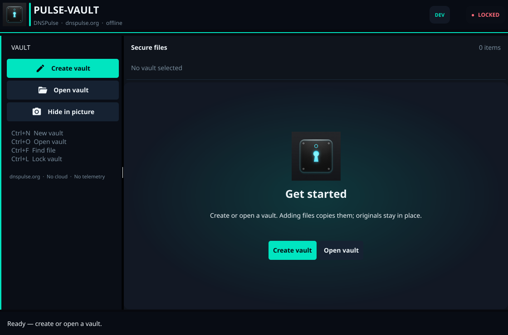
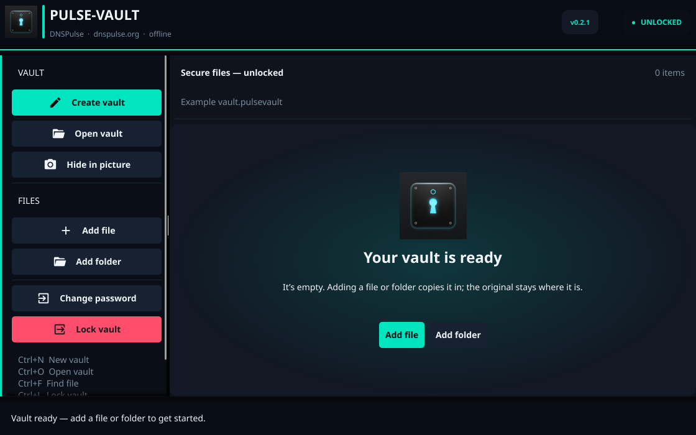
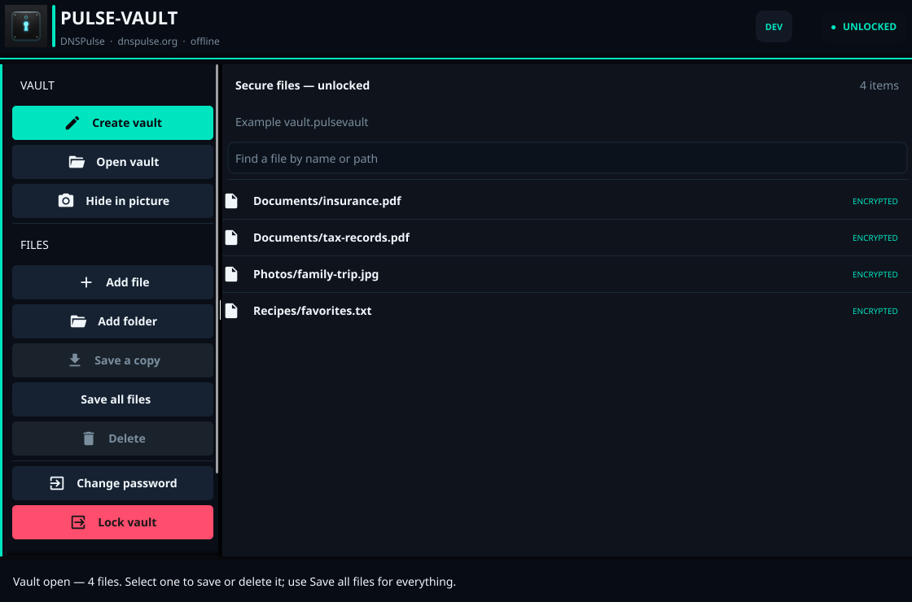
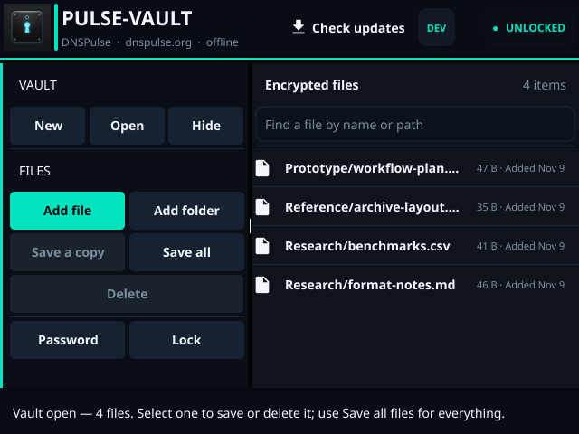
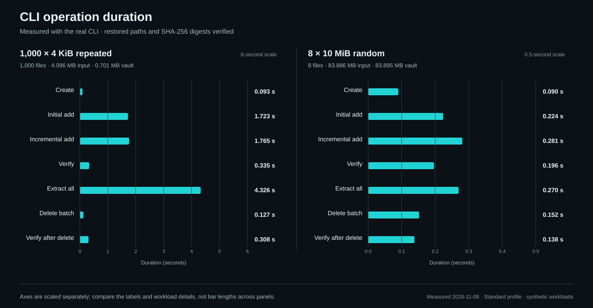
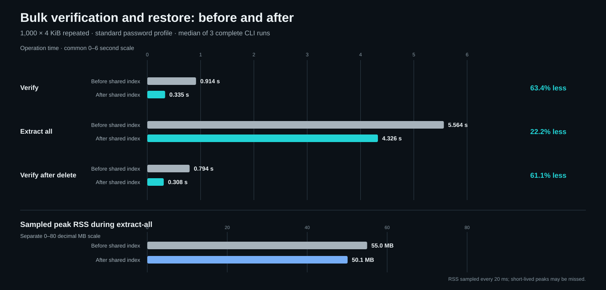
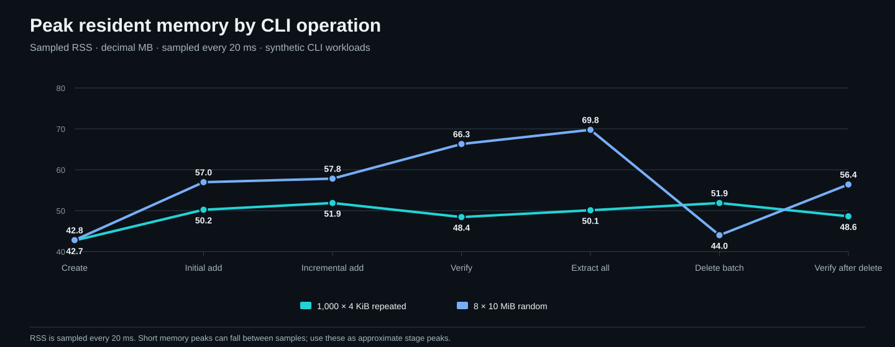
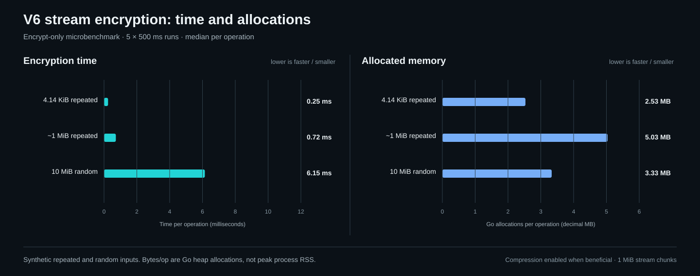
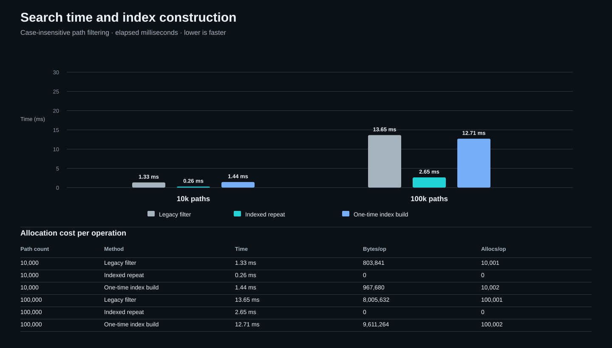
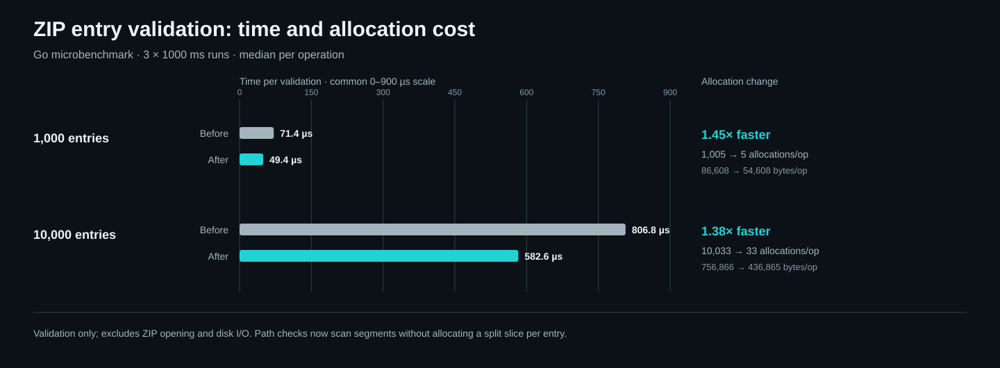

# Pulse-Vault

[](https://github.com/Z3r0s/Pulse-Vault/actions/workflows/test.yml)
[](https://github.com/Z3r0s/Pulse-Vault/actions/workflows/codeql.yml)
[](https://github.com/Z3r0s/Pulse-Vault/releases/latest)
[](CHANGELOG.md)

**Keep a private copy of important files on your own computer or removable drive.** Pulse-Vault stores them in one password-protected file that works offline. It has a desktop app and a command-line tool, built in Go.

[Start in two minutes](docs/TWO_MINUTE_GUIDE.md) · [CLI guide](docs/CLI_GUIDE.md) · [Download](https://github.com/Z3r0s/Pulse-Vault/releases) · [Install guide](INSTALL.md) · [GitHub Issues](https://github.com/Z3r0s/Pulse-Vault/issues) · [Report a security issue](SECURITY.md)

| Explore Pulse-Vault | What you can see |
| --- | --- |
| [Desktop walkthrough](docs/TWO_MINUTE_GUIDE.md) | Create a vault, add files, lock it, and restore a file. |
| [Interactive performance explorer](https://z3r0s.github.io/Pulse-Vault/performance/) | Move through seven measured CLI operations and compare timings, memory, and search costs. [Read the measurements on GitHub](docs/PERFORMANCE.md). |
| [Encrypt and decrypt in your browser](https://z3r0s.github.io/Pulse-Vault/crypto/) | Run the Go/WASM demo with synthetic data, then follow the stream format and Go crypto API research. [Read the protocol on GitHub](docs/CRYPTO_PROTOCOL.md). |
| [Threat model](docs/THREAT_MODEL.md) | See what the format protects, what remains visible, and where its guarantees end. |

The interactive demos are published through GitHub Pages. The linked repository docs contain the static charts, benchmark commands, and protocol details for readers browsing a branch or fork.


## A practical use for Pulse-Vault

Use it for personal records, a small project archive, or files you want to carry on a USB drive without leaving them readable there. Create a vault, add files or a folder, then lock it. Open it later with your password to check or restore those files.

Pulse-Vault is local storage, not a backup service. Keep a separate backup of the `.pulsevault` file, and keep your password somewhere safe. There is no password recovery.

## Quick start

### Desktop app

Follow the [two-minute desktop guide](docs/TWO_MINUTE_GUIDE.md) to create a vault, add a file, reopen it, and test a restore. Download the app for your operating system from [GitHub Releases](https://github.com/Z3r0s/Pulse-Vault/releases); the [install guide](INSTALL.md) covers source builds if your release asset is unavailable.

The GUI works offline. It does not create an account or sync your files. An empty unlocked vault offers **Add file** and **Add folder** directly; once files are present, the workspace adds path search, **Save a copy**, and **Save all files**.

The GUI makes no server request during launch, idle use, or vault operations. At launch, it asks whether you want to check for updates; **Not now** makes no request, and **Privacy info** explains that GitHub can see the source IP and request time after you choose **Check now**. You can route that request through a VPN or configure `HTTPS_PROXY` before starting the app. Update downloads are a separate opt-in action, saved to a location you choose, and checked against the release's `SHA256SUMS`; the app never installs an update automatically. The checksum is hosted by the same GitHub release, so it checks file consistency but is not an independent publisher signature.

On desktop builds with tray support, closing the window locks the current vault and hides Pulse-Vault in the notification area. Click the tray icon or choose **Show Pulse-Vault** to reopen it; choose **Exit Pulse-Vault** to quit. Windows may place the icon under the notification area's **Show hidden icons** arrow, depending on its taskbar settings.



[View the desktop capture at full 1440p resolution (2560×1440)](docs/assets/pulse-vault-desktop-1440p.png).

<details>
<summary>See the empty vault, searchable file list, and compact layout</summary>

The desktop flow moves from a locked start screen to an empty vault with direct add actions, then to a searchable file list. These captures use synthetic sample names:







[View a selected file and its available actions in the compact layout](docs/assets/pulse-vault-compact-actions.png).

</details>

### Command line

In an interactive terminal, commands prompt for passwords without echoing them. This example creates a vault, adds a folder and a file, checks its contents, and restores it:

```text
pulse-vault create family-records
pulse-vault add family-records.pulsevault ./records ./insurance.pdf
pulse-vault list family-records.pulsevault
pulse-vault verify family-records.pulsevault
pulse-vault extract-all family-records.pulsevault ./restored
```

Adding `./records` stores the contents of that folder at the vault root; paths beneath it are preserved. Restore into an empty folder the first time, then open a restored file to confirm it is usable.

For scripts, provide a password through a protected file or standard input:

```powershell
pulse-vault list .\family-records.pulsevault --password-file .\vault-password.txt
```

```bash
pulse-vault list ./family-records.pulsevault --password-file ./vault-password.txt
```

Avoid `--password <value>` for routine use: command arguments can be saved in shell history or visible to other local processes. The option remains available for compatibility. See the [CLI guide](docs/CLI_GUIDE.md) for command details and automation guidance.

## What it does

- Creates one portable `.pulsevault` file for a collection of files.
- Adds individual files, multiple files, or a folder tree while preserving relative paths.
- Removes several vault entries in one validated, atomic rewrite.
- Restores one file or the full folder tree, with overwrite checks.
- Verifies authenticated streams and recorded SHA-256 digests.
- Uses a virtualized file browser with path search, per-file size and added date, and keyboard commands for common actions.
- Re-encrypts vault contents when you change the password.
- Can append a vault to an image or video file. The carrier still opens as media, but this is a disguise and does not hide the vault from forensic inspection.
- Provides a Go desktop app and a Go CLI. The optional `pip install pulse-vault` package is only a launcher for the Go CLI; normal CLI use stays offline, with `pulse-vault --launcher-install` or `--launcher-update` required to fetch its binary. The retired Python implementation is archived under [`legacy/python/`](legacy/python/).


## Performance, with the workload shown

The [interactive performance explorer](https://z3r0s.github.io/Pulse-Vault/performance/) lets you switch between measured CLI workloads and move the operation slider through create, initial add, incremental add, verify, restore, batch delete, and a final integrity check. It also shows sampled memory, search time and allocations, a recycled GUI row-update measurement, bulk-add path-conflict checks, and ZIP validation costs. These synthetic reference workloads report medians of three complete runs; the explorer explains the workloads, scales, and limits. GitHub Pages needs the one-time setup described in the [benchmark notes](docs/PERFORMANCE.md) before the link is live.



| Measured result | Scope |
| --- | --- |
| **2.73× faster verification** | Reused ZIP index on the 1,000-file repeated-data workload, compared with scanning the archive for each file. |
| **2.65 ms per indexed search** | Median at 100,000 paths after a 12.71 ms index build. |
| **10,033 → 33 allocations** | Per operation in the isolated 10,000-entry ZIP path validation benchmark. |

<details>
<summary>See the remaining charts, workloads, and measurement limits</summary>

The repeated-data run uses 1,000 files of 4 KiB; the random-data run uses eight files of 10 MiB. The median repeated-data batch removes 100 entries in 0.127 seconds; the random-data batch removes four in 0.152 seconds. Each delete is followed by an integrity check of the remaining entries. Bulk verify and extract reuse one validated ZIP index; on the repeated-data workload, verify measured 2.73× faster and extract-all 22.2% less time than the previous per-file archive scan. See the [method and before/after measurements](docs/PERFORMANCE.md#bulk-archive-lookup-improvement).





Memory is shown in decimal megabytes and sampled every 20 ms, so very short peaks may not appear. The vault shrank from 0.701 MB to 0.631 MB after removing 100 repeated-data files, and from 83.895 MB to 41.948 MB after removing four random-data files.



The isolated stream benchmark reports medians of five 500 ms runs: 0.25 ms for a 4.14 KiB repeated file, 0.72 ms for a roughly 1 MiB repeated file, and 6.15 ms for a 10 MiB random file. Reusing chunk nonce and authentication buffers reduced allocations on the random-file case from 77 to 48 per operation without changing the format. Go heap allocations are shown separately from sampled process memory.

The virtualized desktop list's recycled-row update measured 1.727 µs/op, 336 B/op, and 8 allocations across five one-second runs. This isolates updating one row and refreshing its container; it does not measure native painting, scrolling, or whole-frame time.



At 100,000 paths, repeated indexed searches took a median 2.65 ms with zero allocations after a 12.71 ms index build; the one-time cost is offset after about two searches. The [path-conflict graph](docs/assets/performance-path-index.svg) shows a 15.3× median improvement for the Unicode-aware bulk-add index over the former nested scan with 10,000 stored and 100 incoming paths. Search and path-conflict Go benchmarks use three 200 ms runs; stream-encryption benchmarks use five 500 ms runs.



In the direct 10,000-entry validation benchmark, median time dropped from 807 µs to 583 µs, allocations fell from 10,033 to 33 per operation, and allocated bytes fell by about 42%. This benchmark excludes ZIP opening and disk I/O; the [measurement notes](docs/PERFORMANCE.md#zip-entry-validation-allocation-reduction) include the command and limits.

</details>

The [benchmark method and full result tables](docs/PERFORMANCE.md) explain the workloads, measurement limits, and commands used to reproduce these figures. The separate [cryptography research page](https://z3r0s.github.io/Pulse-Vault/crypto/) traces the current file-encryption stream, runs a local Go/WASM encrypt/decrypt demonstration, and explains what the 71.4 µs ZIP-validation baseline measures. It also explores a project-owned Go crypto API, file-vault key rotation, future KDF/AEAD choices, Go memory limits, post-quantum file sharing, rollback and metadata boundaries, and the philosophical tradeoffs behind a small, reviewable protocol.

## Preview the docs site locally

On Windows, run `.\scripts\preview-docs.ps1` in PowerShell. It builds the local crypto demonstration with the active Go toolchain and serves the `docs/` site at `http://127.0.0.1:8765/`. Use `-Port 8766` if that port is already occupied. The generated WebAssembly binary and matching Go runtime file are ignored build artifacts; the demo uses only its public synthetic sample and never opens a vault.

## Security and limitations

Pulse-Vault encrypts the stored copy of your files. It does not erase the originals, securely wipe deleted data, encrypt your whole computer, or protect files after you extract them. Anyone who can unlock your account while the vault is open may be able to access the decrypted contents.

The password is the recovery key. If you lose it, Pulse-Vault cannot recover the vault. File names, paths, and the manifest are encrypted, but the ZIP entry count, encrypted blob sizes, format and KDF parameters, and total vault size remain visible. A local `.pulsevault` file and its application binary can be inspected; protection comes from encryption and authentication, not hiding the file format or source. Release builds omit local paths, VCS metadata, and symbol/debug tables to reduce incidental build details, but remain disassemblable. Hiding a vault after media does not make it invisible.

New file streams use authenticated ChaCha20-Poly1305 and AES-GCM in a two-stage construction, with Scrypt for password-based key derivation and zstd compression when it helps. The stream format authenticates chunk order and includes a final record so truncation is detected. See the [protocol specification](docs/CRYPTO_PROTOCOL.md), [container format](docs/VAULT_FORMAT.md), and [threat model](docs/THREAT_MODEL.md) for details and limits.

## Get it

- **Windows desktop:** download `pulse-vault-gui-windows-amd64.exe` from [Releases](https://github.com/Z3r0s/Pulse-Vault/releases).
- **Windows CLI:** use the release binary or `scripts/install.ps1`.
- **Linux and macOS CLI:** use `scripts/install.sh` or build from source.
- **From a clone:** `./cli.sh version` or `.\cli.ps1 version` builds/runs the CLI without requiring the GUI toolchain.
- **Go install:** `go install github.com/Z3r0s/Pulse-Vault/gui-go/cmd/pulse-vault@latest`.
- **pip launcher:** `pip install -U pulse-vault` installs a Python package that downloads and verifies the Go CLI; it is not the vault engine.

See [Downloads](docs/DOWNLOADS.md) for release assets and [INSTALL.md](INSTALL.md) for platform-specific steps. If a release does not include a binary for your system, build from source as described there.

## For developers

The Go module is at the repository root. The GUI and CLI source live in [`gui-go/`](gui-go/). The vault implementation uses Go's standard library plus Fyne, `golang.org/x/crypto`, `github.com/klauspost/compress` for zstd, and `github.com/ulikunitz/xz` to read older streams.

```powershell
go test ./gui-go/internal/crypto ./gui-go/internal/vault ./gui-go/internal/ui ./gui-go/cmd/pulse-vault ./gui-go/crypto -count=1
```

The GUI build needs CGO and a platform C toolchain. The CLI builds without CGO. See [developer notes](gui-go/README.md) for build and test instructions.

The public Go crypto package is available at `github.com/Z3r0s/Pulse-Vault/gui-go/crypto`. Protocol changes need a new or explicit format rule, updated documentation, compatibility vectors, and tamper/truncation tests.

## More documentation

- [Two-minute guide](docs/TWO_MINUTE_GUIDE.md) · [CLI guide](docs/CLI_GUIDE.md) · [Installation](INSTALL.md) · [Downloads](docs/DOWNLOADS.md) · [Changelog](CHANGELOG.md)
- [Vault format](docs/VAULT_FORMAT.md) · [Cryptographic protocol](docs/CRYPTO_PROTOCOL.md) · [Threat model](docs/THREAT_MODEL.md)
- [Interactive performance explorer](https://z3r0s.github.io/Pulse-Vault/performance/) · [Cryptography and Go library research](https://z3r0s.github.io/Pulse-Vault/crypto/) · [Performance testing and charts](docs/PERFORMANCE.md) · [Engineering overview](docs/WHY_GO.md)
- [Contributing](CONTRIBUTING.md) · [Security policy](SECURITY.md) · [Roadmap](docs/ROADMAP.md)

Pulse-Vault is maintained by [DNSPulse](https://dnspulse.org) and licensed under MIT. See [LICENSE](LICENSE).
