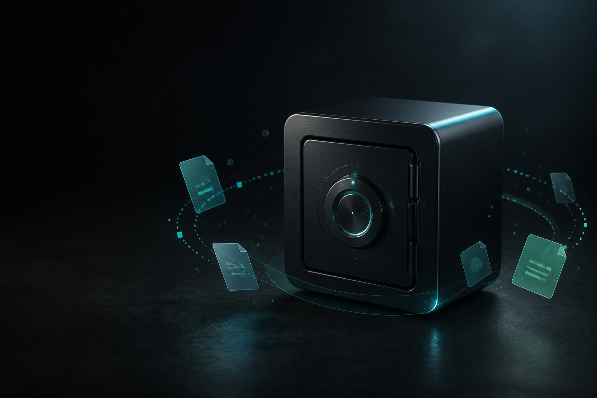

# Pulse-Vault

[](https://github.com/Z3r0s/Pulse-Vault/actions/workflows/test.yml)
[](https://github.com/Z3r0s/Pulse-Vault/releases/latest)
[](CHANGELOG.md)



**Keep a private copy of important files on your own computer or removable drive.** Pulse-Vault stores them in one password-protected file that works offline. It has a desktop app and a command-line tool, built in Go.

[Start in two minutes](docs/TWO_MINUTE_GUIDE.md) · [CLI guide](docs/CLI_GUIDE.md) · [Download](https://github.com/Z3r0s/Pulse-Vault/releases) · [Install guide](INSTALL.md) · [GitHub Issues](https://github.com/Z3r0s/Pulse-Vault/issues) · [Report a security issue](SECURITY.md)

## A practical use for Pulse-Vault

Use it for personal records, a small project archive, or files you want to carry on a USB drive without leaving them readable there. Create a vault, add files or a folder, then lock it. Open it later with your password to check or restore those files.

Pulse-Vault is local storage, not a backup service. Keep a separate backup of the `.pulsevault` file, and keep your password somewhere safe. There is no password recovery.

## Quick start

### Desktop app

Follow the [two-minute desktop guide](docs/TWO_MINUTE_GUIDE.md) to create a vault, add a file, reopen it, and test a restore. Download the app for your operating system from [GitHub Releases](https://github.com/Z3r0s/Pulse-Vault/releases); the [install guide](INSTALL.md) covers source builds if your release asset is unavailable.

The GUI works offline. It does not create an account or sync your files.


[View the desktop capture at full 1440p resolution (2560×1440)](docs/assets/pulse-vault-desktop-1440p.png).

### Command line

In an interactive terminal, commands prompt for passwords without echoing them. This example creates a vault, adds a folder and a file, checks its contents, and restores it:

```text
pulse-vault create family-records
pulse-vault add family-records.pulsevault ./records ./insurance.pdf
pulse-vault list family-records.pulsevault
pulse-vault verify family-records.pulsevault
pulse-vault extract-all family-records.pulsevault ./restored
```

Adding `./records` stores the contents of that folder at the vault root; paths beneath it are preserved. Restore into an empty folder the first time, then open a restored file to confirm it is usable.

For scripts, provide a password through a protected file or standard input:

```powershell
pulse-vault list .\family-records.pulsevault --password-file .\vault-password.txt
```

```bash
pulse-vault list ./family-records.pulsevault --password-file ./vault-password.txt
```

Avoid `--password <value>` for routine use: command arguments can be saved in shell history or visible to other local processes. The option remains available for compatibility. See the [CLI guide](docs/CLI_GUIDE.md) for command details and automation guidance.

## What it does

- Creates one portable `.pulsevault` file for a collection of files.
- Adds individual files, multiple files, or a folder tree while preserving relative paths.
- Restores one file or the full folder tree, with overwrite checks.
- Verifies authenticated streams and recorded SHA-256 digests.
- Re-encrypts vault contents when you change the password.
- Can append a vault to an image or video file. The carrier still opens as media, but this is a disguise and does not hide the vault from forensic inspection.
- Provides a Go desktop app and a Go CLI. The optional `pip install pulse-vault` package is only a launcher for the Go CLI; the retired Python implementation is archived under [`legacy/python/`](legacy/python/).


## Security and limitations

Pulse-Vault encrypts the stored copy of your files. It does not erase the originals, securely wipe deleted data, encrypt your whole computer, or protect files after you extract them. Anyone who can unlock your account while the vault is open may be able to access the decrypted contents.

The password is the recovery key. If you lose it, Pulse-Vault cannot recover the vault. File names and metadata are encrypted; the vault file size and the presence of a carrier may still be observable. Hiding a vault after media does not make it invisible.

New file streams use authenticated ChaCha20-Poly1305 and AES-GCM in a two-stage construction, with Scrypt for password-based key derivation and zstd compression when it helps. The stream format authenticates chunk order and includes a final record so truncation is detected. See the [protocol specification](docs/CRYPTO_PROTOCOL.md), [container format](docs/VAULT_FORMAT.md), and [threat model](docs/THREAT_MODEL.md) for details and limits.

## Get it

- **Windows desktop:** download `pulse-vault-gui-windows-amd64.exe` from [Releases](https://github.com/Z3r0s/Pulse-Vault/releases).
- **Windows CLI:** use the release binary or `scripts/install.ps1`.
- **Linux and macOS CLI:** use `scripts/install.sh` or build from source.
- **From a clone:** `./cli.sh version` or `.\cli.ps1 version` builds/runs the CLI without requiring the GUI toolchain.
- **Go install:** `go install github.com/Z3r0s/Pulse-Vault/gui-go/cmd/pulse-vault@latest`.
- **pip launcher:** `pip install -U pulse-vault` installs a Python package that downloads and verifies the Go CLI; it is not the vault engine.

See [Downloads](docs/DOWNLOADS.md) for release assets and [INSTALL.md](INSTALL.md) for platform-specific steps. If a release does not include a binary for your system, build from source as described there.

## For developers

The Go module is at the repository root. The GUI and CLI source live in [`gui-go/`](gui-go/). The vault implementation uses Go's standard library plus Fyne, `golang.org/x/crypto`, `github.com/klauspost/compress` for zstd, and `github.com/ulikunitz/xz` to read older streams.

```powershell
go test ./gui-go/internal/crypto ./gui-go/internal/vault ./gui-go/internal/ui ./gui-go/cmd/pulse-vault ./gui-go/crypto -count=1
```

The GUI build needs CGO and a platform C toolchain. The CLI builds without CGO. See [developer notes](gui-go/README.md) for build and test instructions.

The public Go crypto package is available at `github.com/Z3r0s/Pulse-Vault/gui-go/crypto`. Protocol changes need a new or explicit format rule, updated documentation, compatibility vectors, and tamper/truncation tests.

## More documentation

- [Two-minute guide](docs/TWO_MINUTE_GUIDE.md) · [CLI guide](docs/CLI_GUIDE.md) · [Installation](INSTALL.md) · [Downloads](docs/DOWNLOADS.md) · [Changelog](CHANGELOG.md)
- [Vault format](docs/VAULT_FORMAT.md) · [Cryptographic protocol](docs/CRYPTO_PROTOCOL.md) · [Threat model](docs/THREAT_MODEL.md)
- [Contributing](CONTRIBUTING.md) · [Performance testing](docs/PERFORMANCE.md) · [Security policy](SECURITY.md) · [Roadmap](docs/ROADMAP.md)

Pulse-Vault is maintained by [DNSPulse](https://dnspulse.org) and licensed under MIT. See [LICENSE](LICENSE).
