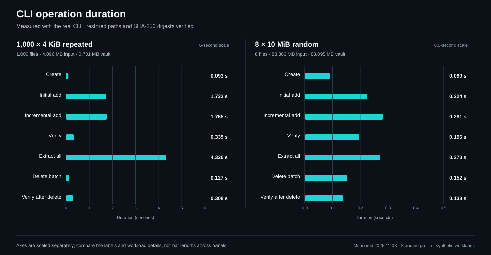
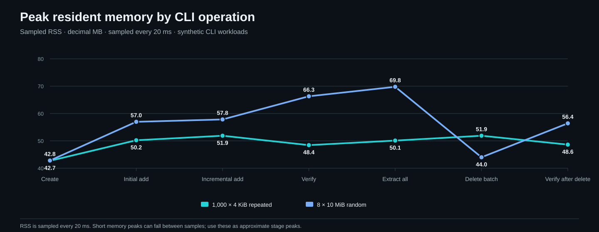
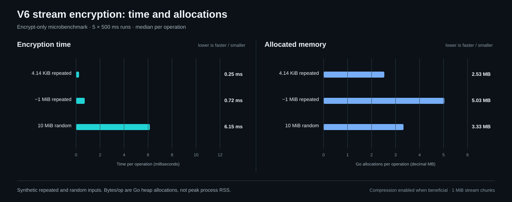
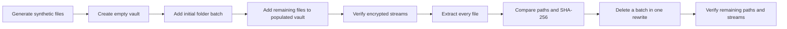
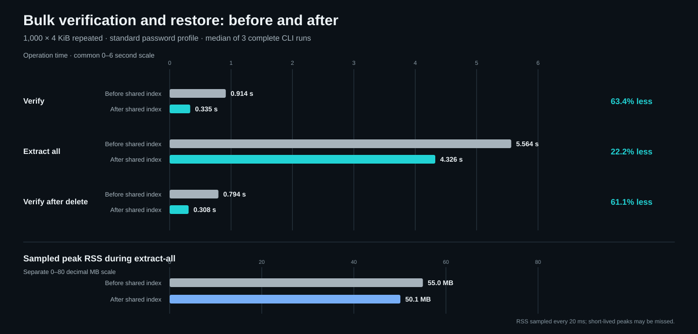
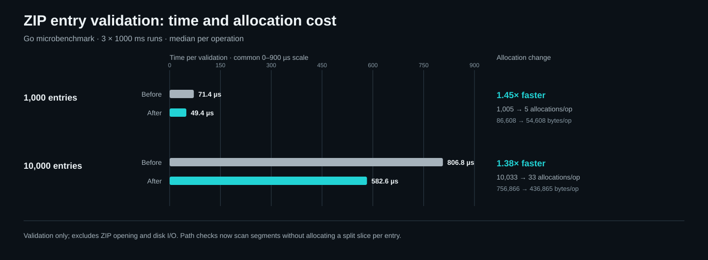
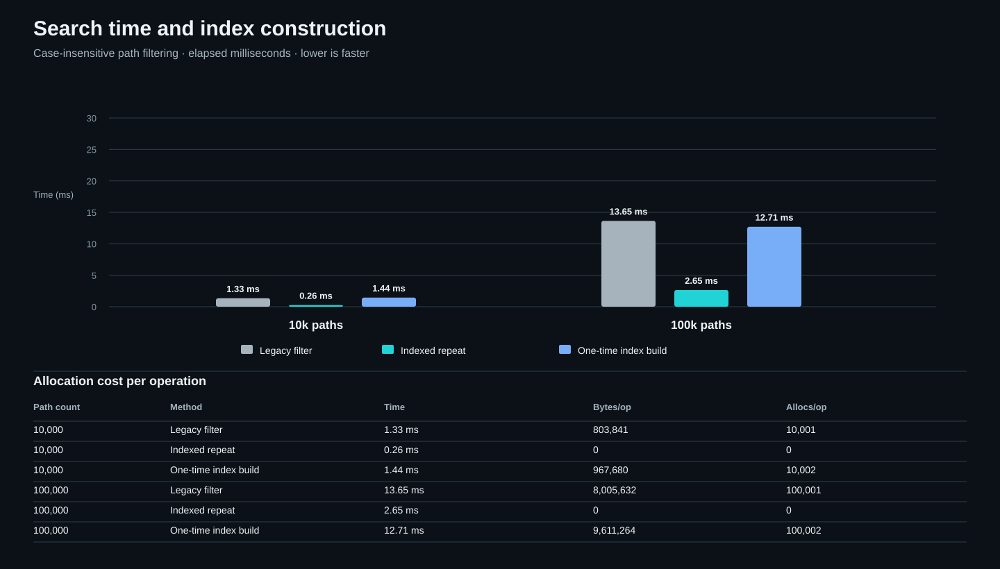
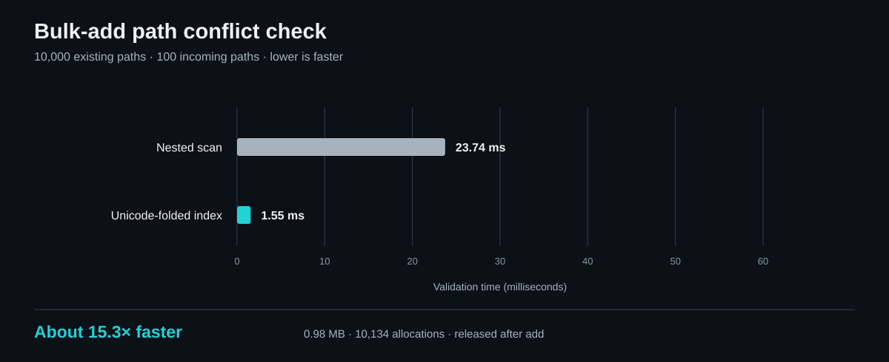

# Measuring Pulse-Vault

[Open the interactive performance explorer](https://z3r0s.github.io/Pulse-Vault/) to switch between the recorded workloads, move through operations with a keyboard-accessible slider, and inspect the memory, search, path-conflict, and ZIP-validation charts. GitHub's repository Markdown displays the SVG figures below as static images; the interactive controls run on GitHub Pages.

GitHub Pages needs to be enabled once for this repository. In **Settings → Pages**, set the publishing source to **GitHub Actions**. After that, `.github/workflows/pages.yml` publishes the documentation site from `docs/` whenever the site, crypto demo, or publishing workflow changes on `main`. The site contains only repository documentation and synthetic benchmark samples, not vault files or personal data. See the [cryptography and Go library research page](https://z3r0s.github.io/Pulse-Vault/crypto/) for the protocol walkthrough and interactive local encrypt demo.

The CLI benchmark exercises the same vault implementation used by the desktop app. It creates disposable synthetic files in a temporary directory, builds a vault, adds half the folder tree, adds the remaining files to that populated vault, verifies it, restores it, and checks the SHA-256 digest and path of every restored file. It then deletes up to 100 entries in one CLI batch and verifies the remaining vault. It removes the temporary data when finished. Separate Go benchmarks measure GUI filename filtering and allocations; neither benchmark measures GUI rendering or startup.

From the repository root, build the CLI and run the benchmark:

```sh
go build -o pulse-vault ./gui-go/cmd/pulse-vault
python scripts/benchmark-cli.py ./pulse-vault --files 1000 --bytes-per-file 4096 --runs 3
python scripts/benchmark-cli.py ./pulse-vault --files 8 --bytes-per-file 10485760 --content random --runs 3
```

On Windows, build `pulse-vault.exe` and pass that filename instead. Output is JSON with operation times, input and vault sizes, deleted and remaining counts, and the number of restored files checked. The harness samples each CLI process's resident memory every 20 ms with `psutil` when installed and falls back to Linux `/proc` otherwise. On other systems without `psutil`, memory values are `null`. Pass `--require-memory-sampling` in automation to fail if an operation has no RSS sample. Sampling can miss short-lived peaks and does not include other processes.

The default `standard` password profile reflects normal use. `--profile fast` is for disposable tests only: it enables the deliberately weaker test-only KDF and must never be used for real vaults. Repeated content compresses unusually well; `--content random` provides a less compressible comparison. Disk cache, storage, CPU load, file count, compression, KDF settings, and operating system all affect results. Compare runs on the same machine and workload; don't treat them as universal speed claims.

## Reference measurements

These reference runs use the real CLI with the standard password profile and disposable synthetic files. Each workload runs three complete times; the charts and table report the median. The harness creates the inputs, adds half of the folder tree to a new vault, adds the remaining half to that populated vault, verifies the vault, extracts every file, compares every restored SHA-256 digest, deletes up to 100 names in one batch, and verifies the remaining entries. It removes its temporary files afterward. Measurements are from November 8, 2026.

The published data omits host, operating-system, hardware, architecture, and account identifiers.

The bars show operation duration in seconds. The repeated-data and random-data panels use separate scales because their times differ substantially; compare the printed values and workload labels rather than bar length across panels.



Memory samples help show how process RSS changes through each stage. They are sampled every 20 ms, so brief peaks may be missed.



An isolated V6 stream benchmark separates per-file encryption cost from password derivation and vault rewrites. It encrypts a small repeated file, a roughly 1 MiB repeated file, and a 10 MiB random file with compression enabled when beneficial. The chart reports median latency and Go heap bytes allocated per encryption operation; allocations are not process RSS.



The benchmark follows this sequence; batch delete removes up to 100 names from the initially added folder in one atomic archive rewrite:



| Workload | Operation | Time | Sampled peak RSS |
| --- | --- | ---: | ---: |
| 1,000 × 4 KiB repeated | Create | 0.093 s | 42.7 MB |
| 1,000 × 4 KiB repeated | Initial add | 1.723 s | 50.2 MB |
| 1,000 × 4 KiB repeated | Add to populated vault | 1.765 s | 51.9 MB |
| 1,000 × 4 KiB repeated | Verify | 0.335 s | 48.4 MB |
| 1,000 × 4 KiB repeated | Extract all | 4.326 s | 50.1 MB |
| 1,000 × 4 KiB repeated | Delete 100 entries | 0.127 s | 51.9 MB |
| 1,000 × 4 KiB repeated | Verify remaining 900 | 0.308 s | 48.6 MB |
| 8 × 10 MiB random | Create | 0.090 s | 42.8 MB |
| 8 × 10 MiB random | Initial add | 0.224 s | 57.0 MB |
| 8 × 10 MiB random | Add to populated vault | 0.281 s | 57.8 MB |
| 8 × 10 MiB random | Verify | 0.196 s | 66.3 MB |
| 8 × 10 MiB random | Extract all | 0.270 s | 69.8 MB |
| 8 × 10 MiB random | Delete 4 entries | 0.152 s | 44.0 MB |
| 8 × 10 MiB random | Verify remaining 4 | 0.138 s | 56.4 MB |

| Workload | Input | Entries deleted / remaining | Vault before / after delete |
| --- | ---: | ---: | ---: |
| 1,000 × 4 KiB repeated | 4.096 MB | 100 / 900 | 0.701 / 0.631 MB |
| 8 × 10 MiB random | 80 MiB | 4 / 4 | 83.895 / 41.948 MB |

RSS is sampled every 20 ms, so short peaks may be missed. The repeated-data workload compresses significantly; use the random workload when estimating already-compressed media or archives.

### Bulk archive lookup improvement

Bulk verify and extract previously reopened the ZIP archive and searched its directory for every file. They now validate and index the archive once per operation, then reuse the matching encrypted entry. In three-run standard-profile measurements for 1,000 × 4 KiB repeated files, verify decreased from 0.914 s to 0.335 s (2.73× faster), extract-all decreased from 5.564 s to 4.326 s (22.2% less time), and verification after deleting 100 entries decreased from 0.794 s to 0.308 s (2.57× faster). The sampled peak RSS during extract-all fell from 55.0 MB to 50.1 MB (4.9 MB lower). These results describe this synthetic workload and are not a universal performance guarantee.



### ZIP entry validation allocation reduction

ZIP validation previously used `strings.Split` for every member path. The path safety rules now scan slash-delimited segments with `strings.Cut`, which avoids allocating a path slice per entry. The direct Go microbenchmark creates synthetic ZIP entry headers and calls `validateZip`; it excludes opening an archive and disk I/O. Each result is the median of three one-second runs.

| ZIP entries | Before | After | Speedup | Bytes/op, before → after | Allocs/op, before → after |
| ---: | ---: | ---: | ---: | ---: | ---: |
| 1,000 | 71.4 µs | 49.4 µs | 1.45× | 86,608 → 54,608 | 1,005 → 5 |
| 10,000 | 806.8 µs | 582.6 µs | 1.38× | 756,866 → 436,865 | 10,033 → 33 |

The 10,000-entry case uses about 42% fewer allocated bytes and 99.7% fewer allocations. This microbenchmark measures validation only, not full unlock time.



Reproduce it with:

```sh
cd gui-go
go test ./internal/vault -run=^$ -bench=BenchmarkValidateZip -benchmem -benchtime=1s -count=3
```

The GUI filename filter has timing and allocation benchmarks. Run them with:

```sh
go test ./gui-go/internal/ui -run=^$ -bench=BenchmarkFileNameFilter -benchmem -benchtime=200ms -count=3
go test ./gui-go/internal/vault -run=^$ -bench=BenchmarkAddPathConflictValidation -benchmem -benchtime=200ms -count=3
```

Virtualized file rows update the name and metadata before refreshing the row container once. Across five one-second runs, the isolated row-update benchmark measured a median of 1.727 µs/op, 336 B/op, and 8 allocations. It measures updating one recycled Fyne row and refreshing its container; it excludes canvas painting, native frame time, startup, and scrolling. Run it with:

```sh
go test ./gui-go/internal/ui -run=^$ -bench=BenchmarkUpdateFileListRow -benchmem -benchtime=1s -count=5
```

The grouped graph reports search latency for 10,000 and 100,000 mixed-case paths. The table below it includes both allocations per operation and bytes allocated, so the one-time index-building cost can be compared with repeated queries.



| Paths | Operation | Time | Bytes/op | Allocs/op |
| ---: | --- | ---: | ---: | ---: |
| 10,000 | Legacy filter | 1.33 ms | 803,841 | 10,001 |
| 10,000 | Indexed repeat | 0.26 ms | 0 | 0 |
| 10,000 | Index build | 1.44 ms | 967,680 | 10,002 |
| 100,000 | Legacy filter | 13.65 ms | 8,005,632 | 100,001 |
| 100,000 | Indexed repeat | 2.65 ms | 0 | 0 |
| 100,000 | Index build | 12.71 ms | 9,611,264 | 100,002 |

The V6 stream benchmark runs each synthetic payload for 500 ms and repeats each case five times. The table and chart show the median of those runs. Chunk nonce and authentication-data buffers are reused while processing each stream. The 10 MiB random case dropped from 77 to 48 allocations per operation with a similar median encryption time.

| Input | Median encryption | Bytes/op | Allocs/op |
| --- | ---: | ---: | ---: |
| 4.14 KiB repeated | 0.25 ms | 2,531,530 | 76 |
| ~1 MiB repeated | 0.72 ms | 5,033,348 | 112 |
| 10 MiB random | 6.15 ms | 3,332,168 | 48 |

Bytes/op are cumulative Go heap allocations, not peak resident memory. The benchmark includes stream framing and compression selection, and does not include password derivation or ZIP rewrite costs.

Clearing a search releases the folded-name cache. The measurements cover filtering and index construction, not Fyne painting or window startup.

The incremental-add conflict check was measured with 10,000 existing names and 100 incoming names. Its former nested scan took 23.74 ms; the Unicode-aware folded-path index took 1.55 ms and 980,852 bytes across 10,134 temporary allocations, about 15.3× faster. The index is released when the add operation finishes. The Go microbenchmark figures below report the median of three 200 ms runs to reduce one-run timing noise.



The [benchmark data](performance/benchmarks.json) is the single source for the interactive charts and these SVG exports. To refresh the static images after measurements change, run `python scripts/render-performance-charts.py`; CI checks that the images match the data.
