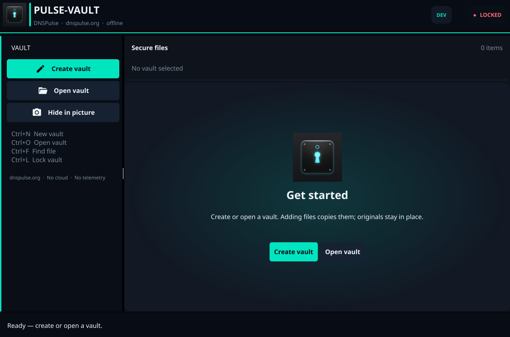
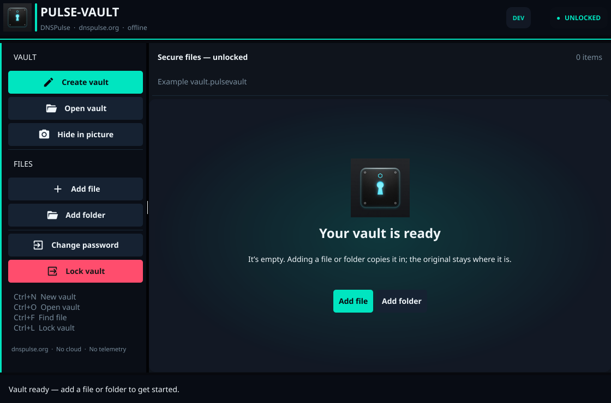
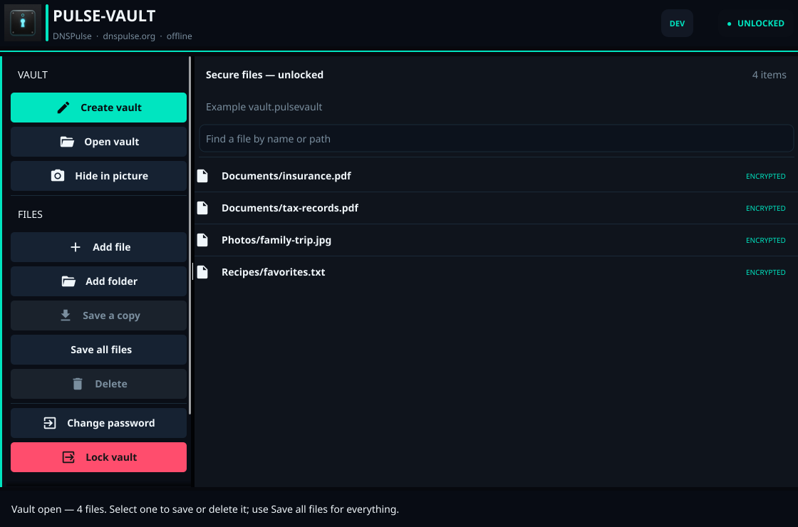

# Your first Pulse-Vault

The first run takes about two minutes with a small test file, after the desktop app is installed. This page also explains where your files go, how to check a restore, and what to keep safe afterward.

Get the app from [GitHub Releases](https://github.com/Z3r0s/Pulse-Vault/releases). Choose the GUI file for your operating system; if there is no matching download, use the [install guide](../INSTALL.md). No account or network connection is needed to use the app after installation.

[Open the same screen at full 1440p resolution (2560×1440)](assets/pulse-vault-desktop-1440p.png).

After you create or open a vault, an empty vault offers **Add file** and **Add folder** in the workspace. With files added, search filters their saved paths and the sidebar offers single-file and full-vault restore actions. The examples below use synthetic file names.

## The two-minute path

Have one small, non-sensitive file ready and create an empty folder for the restored copy. Using a test file lets you learn the flow before relying on a vault for important records.

1. **Create a vault.** Click **Create vault**, choose a location you can find again, and save it as `private-records.pulsevault`. The vault is one file; the location shown near the top of the app is where that file lives.
2. **Choose a password.** Enter and confirm a strong, unique password. Save it in a password manager or another place you control. There is no password reset or recovery service.
3. **Add your test file.** After creation, the empty-vault screen offers **Add file** and **Add folder** directly. Choose **Add file**, select the test file, and wait until the status bar says it was added. The original stays in its original folder. For a directory, use **Add folder**; its files and subfolders are stored inside the vault.
4. **Lock and reopen.** Click **Lock vault**, then **Open vault**. Select `private-records.pulsevault` and enter its password. The file should appear in the list.
5. **Save your files back out.** Click **Save all files** and choose the empty restore folder. Open the restored file and compare it with your original. The app verifies the stored content as it saves each file.
6. **Back up the vault.** Copy the `.pulsevault` file to a different drive or backup location. Keep your password separately. When you change the vault later, update that backup copy too.

You have now checked both directions: a file went into the vault, and the original bytes came back out. Only then should you start adding important files.

## What the controls do

| Control | What to expect |
| --- | --- |
| **Add file** | Adds one selected file. The source file remains on disk. |
| **Add folder** | Adds the selected folder's contents, preserving paths *inside* that folder. On restore, those contents go under the chosen restore folder. |
| **Hide in picture** | Creates a separate vault stored after a picture or video. **Embed in this picture** replaces the selected carrier with the combined file; **Save a copy** keeps the original unchanged. The combined file still opens as a picture or video. |
| **Save a copy** | Saves the selected vault file into a folder you choose. It stays in the vault too. |
| **Save all files** | Saves every vault file into a folder you choose. Use an empty folder for the first test; the app asks before overwriting files. |
| **Change password** | Re-encrypts the vault with a new password. Keep a backup copy nearby and allow temporary disk space. |
| **Lock vault** | Closes the unlocked session. It does not erase source files or saved copies. |

When a vault contains files, use **Find a file by name or path** above the list to filter entries without changing the vault. **Save all files** still saves every entry, including those hidden by the filter. Keyboard shortcuts are **Ctrl+N** for a new vault, **Ctrl+O** to open one, **Ctrl+F** to find a file, and **Ctrl+L** to lock it.

Large adds, saves, and password changes show progress and can take longer than two minutes. The app estimates temporary disk space for operations that rebuild the vault. Keep enough free space on the drive holding the vault, and wait for the completion message before copying or ejecting it.

## Keep the copy usable

- **Vault file:** save a second copy after each meaningful update. Pulse-Vault does not sync or back up files for you.
- **Password:** losing it means losing access to the vault. Do not store it in the same unprotected place as the only vault copy.
- **Originals and restores:** adding a file does not delete the source; extracting creates ordinary readable files. Handle those files as you normally would.
- **Interrupted restore:** files already completed may remain in the output folder. Check that the operation finished and compare the restored contents before depending on them.

If a vault will not open, check the selected file and password first. Keep every copy of the vault while investigating. If a restore reports a damaged file, do not overwrite a known-good backup; see the [threat model](THREAT_MODEL.md) for what integrity checks can and cannot establish.

Prefer a terminal? The [CLI guide](CLI_GUIDE.md) walks through the same create, verify, and restore flow with copyable commands.
